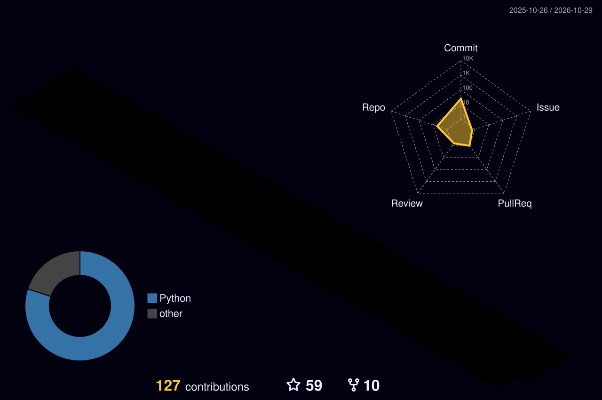

# Zhuoyun Du (杜卓耘)

**Towards machine-native AI agents**

I hope to build agents that develop or learn their own representations, communication protocols, coordination structures, and self-improvement mechanisms.

[📄 Research](https://xiaodu-flying.github.io/research.html) · [🌐 Website](https://xiaodu-flying.github.io/) · [✉️ Contact me](mailto:duzy@zju.edu.cn)

 

- 🙋 Hi! I am **Zhuoyun Du (杜卓耘)**, an M.Eng. student at the State Key Laboratory of CAD&CG, [Zhejiang University](https://www.zju.edu.cn/), advised by Prof. Wei Chen. I expect to graduate in July 2027 and plan to join [HKUST](https://hkust.edu.hk/) for Ph.D. studies in Fall 2027.
- 🔍 My research interests include **multi-agent collaboration**, latent-space communication and reasoning, learned coordination, recursive self-improvement, autonomous evaluation, and foundation-model training and post-training.
- 🧪 My recent work includes [Interlat](https://arxiv.org/abs/2511.09149) on latent-space communication, [EvoPatient](https://arxiv.org/abs/2412.11716) on agent coevolution, and [Croto](https://arxiv.org/abs/2406.08979) on cross-team collaboration.
- 💼 Previously, I worked as a Talent Program intern at **ByteDance**, a research intern at **Alibaba Future Living Lab**, and a research assistant at **THUNLP, Tsinghua University**.
- 🤝 I am seeking **research internship opportunities** and welcome **research collaborations** aligned with these interests. Reach me at [duzy@zju.edu.cn](mailto:duzy@zju.edu.cn).
- 📖 I share notes on my [personal blog](https://xiaodu-flying.notion.site/Welcome-to-my-blog-1d6df6af187d4b3ea1020fcc73aeec43?pvs=4) and longer research-oriented writing on my [website](https://xiaodu-flying.github.io/posts/).
- 🎠 Outside research, I enjoy soccer, fencing, snowboarding, billiards, ballroom dancing, piano, photography, and physics.

<picture>
  <source media="(prefers-color-scheme: dark)" srcset="https://raw.githubusercontent.com/XiaoDu-flying/XiaoDu-flying/output/github-contribution-grid-snake-dark.svg">
  <source media="(prefers-color-scheme: light)" srcset="https://raw.githubusercontent.com/XiaoDu-flying/XiaoDu-flying/output/github-contribution-grid-snake.svg">
  
</picture>

